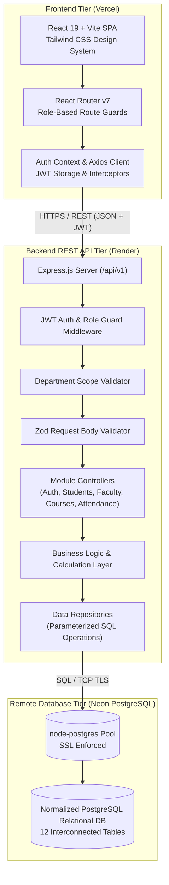
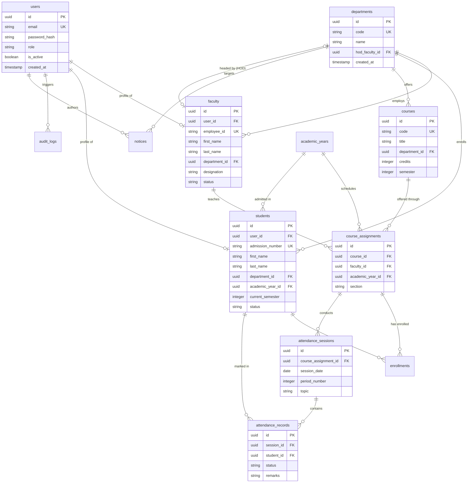
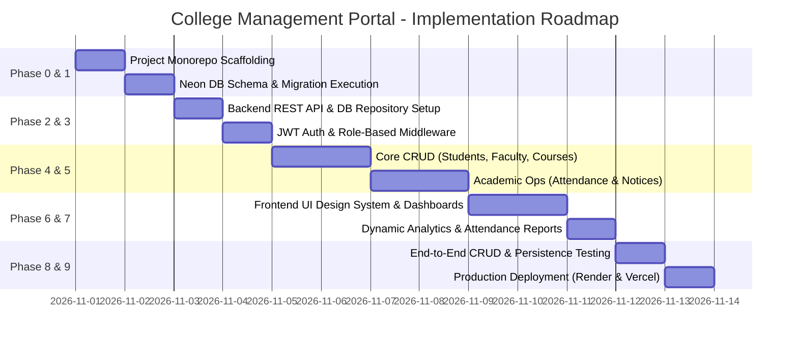

# COLLEGE MANAGEMENT PORTAL (CMP)
## Comprehensive Technical Master Plan & Architecture Blueprint
**Tagline:** One Campus. One Platform. Complete Management.  
**Document Version:** 1.0.0 (Production Blueprint)  
**Target Environment:** Node.js 26+, React 19 / Vite, Neon Remote PostgreSQL, Render, Vercel

---

## 1. Project Requirement Specification

### 1.1 Executive Summary
The **College Management Portal (CMP)** is an enterprise-grade academic administration platform designed to centralize and automate higher education institutional workflows. It manages student life cycles from enrollment through graduation, faculty workload and course allocations, department governance, daily attendance tracking, institutional notices, and multi-tier analytics.

### 1.2 Missing Technical Decisions & Resolution Matrix
Before establishing the architecture, the following critical technical decisions were evaluated and resolved:

| Decision Area | Problem Statement | Architected Resolution | Justification |
| :--- | :--- | :--- | :--- |
| **Attendance On-Duty (OD)** | Should OD count toward attendance percentage or be neutral? | Count as **Present** in attendance percentage: `(Present + OnDuty) / Total * 100` | Accords with NAAC/AICTE and institutional standards where students representing the college in authorized events receive academic credit. |
| **ID Generation Strategy** | Unpredictable or conflicting student admission numbers and employee codes. | Deterministic sequence generator: `CMP-YYYY-DEPT-XXXX` for students; `EMP-DEPT-XXX` for faculty. | Guarantees uniqueness, institutional identification, and chronological tracking without collision. |
| **Primary Key Architecture** | Sequential integer IDs leak institutional volume and are prone to URL enumeration. | Standardized on **UUIDv4** (`gen_random_uuid()`) for database primary keys; business codes used for display. | Hardens against ID enumeration, supports distributed migration, and secures multi-department boundaries. |
| **Record Archival Strategy** | Hard deleting student or faculty cascades and deletes historical attendance & audit trails. | Enforce **Soft Deletion** (`is_active = FALSE`, `status = 'archived'`) on primary entities with REST filter flags. | Regulatory compliance requires preserving transcripts and attendance records indefinitely. |
| **Department Multi-Tenancy** | Risk of HODs viewing/altering records belonging to other academic departments. | **Tenant Scoping Middleware** enforcing `department_id` match on HOD/Staff tokens; Admin maintains bypass. | Strict department boundary isolation at the controller/repository level. |
| **Database Driver Selection** | Potential pool exhaustion in serverless Neon PostgreSQL environments. | Node-Postgres (`pg`) connection pooling with explicit client checkout/release and SSL (`rejectUnauthorized: false`). | Native performance, battle-tested connection management, and full compatibility with Neon pooling proxy. |

---

## 2. Project Objectives & Problem Statement

### 2.1 Problem Statement
Educational institutions often operate with fragmented legacy systems: paper-based daily roll calls, disparate spreadsheets for department records, delayed notification broadcasts, and siloed student data. This causes:
1. Significant administrative overhead and data duplication.
2. High latency in attendance reporting and compliance monitoring.
3. Lack of unified real-time visibility for Deans, HODs, Faculty, and Students.
4. Vulnerability to record tampering and lack of accountability audit trails.

### 2.2 Core Project Objectives
- **Centralized Single Source of Truth:** Unify student, faculty, department, course, and attendance data into a remote relational PostgreSQL store.
- **Strict Role-Based Access Control (RBAC):** Deliver tailored interfaces and authorization barriers for 4 distinct institutional roles.
- **Precision Attendance Tracking:** Provide daily attendance capture with automated statistical aggregation and on-duty credit logic.
- **Real-Time Dynamic Reporting:** Ensure 100% of dashboard analytics are calculated dynamically via parameterized SQL queries with zero hardcoded statistics.
- **Enterprise-Grade Remote Architecture:** Implement an Express REST API connected to remote managed Neon PostgreSQL, deployable to Render and Vercel.

---

## 3. Functional Requirements

### Module 1: Authentication & User Management
- Secure password-based authentication with bcrypt hashing (10 salt rounds).
- Stateless JSON Web Token (JWT) issuance with signed payload containing `userId`, `email`, `role`, and `departmentId`.
- Password change capability with current password verification.
- Account activation, deactivation, and account lockout after repeated failed attempts.
- Role-based route authorization guards at backend API and frontend router.

### Module 2: Student Enrollment Management
- Complete enrollment profile creation: full name, DOB, blood group, contact email, phone, guardian details, address.
- Auto-generation of unique admission numbers (e.g., `CMP-2026-CSE-0101`).
- Assignment to academic department, degree program, semester, and active academic year.
- Full CRUD operations with search, department filtering, pagination, and soft archiving.

### Module 3: Faculty Management
- Faculty profile registration with unique Employee ID, designation (Professor, Associate Prof, Asst Prof, Lecturer), specialization, and qualifications.
- Department affiliation and employment status tracking (`active`, `on_leave`, `resigned`).
- Contact and emergency profile records.
- Faculty CRUD operations, search, and workload directory.

### Module 4: Department Management
- Academic department records (Code, Name, Building, Established Year).
- Assignment of Head of Department (HOD) linked to a faculty record.
- Department-level faculty directory, student roll, and allocated course overview.
- Department statistical summary (student count, faculty count, course count, average attendance).

### Module 5: Course Management & Allocations
- Course creation with course code (e.g., `CS301`), title, credit hours (1-6), semester (1-8), and syllabus summary.
- Course allocation mapping linking a course to a specific faculty member and academic year (`course_assignments`).
- Student course enrollment linking students to active course assignments with enrollment status (`enrolled`, `dropped`, `completed`).
- Credit tracking and capacity management.

### Module 6: Attendance Management & Calculation
- Faculty creation of daily attendance sessions specifying: `course_assignment_id`, `session_date`, `period_number` (1-8), and `session_topic`.
- Roster-based marking interface for all enrolled students with 3 statuses: `PRESENT`, `ABSENT`, `ON_DUTY`.
- Strict unique constraint: `(session_id, student_id)` prevents double-marking.
- Mathematical attendance calculation:
  $$\text{Attendance \%} = \left( \frac{\text{Sessions Marked Present} + \text{Sessions Marked On-Duty}}{\text{Total Sessions Conducted for Course}} \right) \times 100$$
- Semester-wise, student-wise, and course-wise attendance aggregation with deficiency alerts (< 75%).

### Module 7: Internal Notices & Announcements
- Creation of rich announcements with title, body content, priority (`LOW`, `NORMAL`, `HIGH`, `URGENT`), and attachment URL.
- Audience targeting: `COLLEGE_WIDE`, `DEPARTMENT_ONLY` (with `target_department_id`), or `FACULTY_ONLY`.
- Lifecycle management with `publish_date` and `expiry_date`.
- Automated expiry filtering so stale announcements are suppressed.

### Module 8: Role-Specific Dashboards & Dynamic Reporting
- **Admin Dashboard:** Total student count, total faculty count, total active departments, total courses, recent institutional notices, system audit log feed.
- **Department Staff / HOD Dashboard:** Department student count, faculty count, department course offerings, overall department attendance percentage, active department notices.
- **Faculty Dashboard:** List of assigned courses for the active semester, total students across sections, upcoming attendance sessions to mark, recent department notices.
- **Student Dashboard:** Personal registered courses, overall cumulative attendance percentage, subject-wise attendance breakdown, recent announcements, profile summary.

---

## 4. Non-Functional Requirements

- **Performance:** REST API response latency < 200ms for 95% of requests. Database queries optimized with multi-column indexes.
- **Security:** OWASP Top 10 compliance; strict parameterized SQL queries eliminating SQL injection; bcrypt password hashing; HTTP-only headers; CORS restricted to frontend domain.
- **Data Persistence:** Neon remote PostgreSQL ensures ACID-compliant remote persistence; data persists across browser reloads, frontend redeployments, and backend server restarts.
- **Scalability:** Stateless Express server architecture; connection pooling via `pg.Pool`; horizontal scaling ready on cloud PaaS.
- **Usability & Aesthetics:** Modern institutional SaaS UI matching Navy Blue (`#163A63`) and Teal (`#0F9D94`) palette; Inter typography; fully responsive on mobile (375px+), tablet (768px+), and desktop (1280px+).
- **Auditability:** Dedicated `audit_logs` table capturing every state-altering administrative action with IP address and timestamp.

---

## 5. User Roles & Permission Matrix

| Module / Action | Administrator | Dept Staff / HOD | Faculty | Student |
| :--- | :---: | :---: | :---: | :---: |
| **Login / Profile View** | All | All | All | Own Record |
| **Manage Departments** | Full CRUD | View Own | View Own | View Enrolled |
| **Manage Users & Passwords** | Full CRUD | Reset Dept Passwords | Self Only | Self Only |
| **Student Management** | Full CRUD | Dept Students CRUD | View Enrolled | Read Self |
| **Faculty Management** | Full CRUD | Dept Faculty Read/Assign | View Directory | View Assigned |
| **Course Management** | Full CRUD | Dept Courses CRUD | View Assigned | View Enrolled |
| **Course Allocation** | Assign Any | Assign in Dept | View Assigned | None |
| **Student Course Enrollment**| Manage All | Manage Dept Students | View Roster | Read Self |
| **Create Attendance Session**| Yes (Override)| Yes (Dept Courses) | Yes (Assigned) | None |
| **Mark / Edit Attendance** | Yes (Audit Log)| Yes (Dept Audit) | Yes (Own Course) | None |
| **View Attendance Reports** | Institutional | Departmental | Assigned Courses | Personal Only |
| **Create Notices** | College-Wide | Dept-Specific | None | None |
| **View Audit Logs** | Full Read | None | None | None |

---

## 6. Complete System Architecture

The College Management Portal employs a decoupled, production-ready 3-tier architecture:

```
[ Frontend Client (React 19 + Vite) ]
          |  HTTPS / JSON / Bearer JWT
          v
[ Backend REST API Gateway (Node.js + Express.js) ]
  ├── CORS & Security Middleware (Helmet, Rate Limiter)
  ├── Authentication & Role Authorization Middleware
  ├── Department Tenant Scoping Guard
  ├── Zod Schema Validation Layer
  ├── Domain Controllers (HTTP Request / Response handling)
  ├── Domain Services (Business logic, Attendance calculations)
  └── Repository Layer (Parameterized SQL queries via pg Pool)
          |  PostgreSQL Connection Pool / TLS SSL
          v
[ Remote Managed Database (Neon PostgreSQL Cloud) ]
  ├── Relational Tables & Foreign Keys (ON DELETE CASCADE / RESTRICT)
  ├── Functional & Unique Constraints
  ├── Multi-column Indexes
  └── Automated Updated-at Triggers
```

---

## 7. Architecture Diagram



---

## 8. Database Master Design

### 8.1 Schema Conventions & Principles
- **Naming Convention:** `snake_case` for all table names and column names.
- **Primary Keys:** UUIDv4 via `gen_random_uuid()` as primary identifier for all tables.
- **Timestamps:** Every table contains `created_at TIMESTAMP WITH TIME ZONE DEFAULT CURRENT_TIMESTAMP` and `updated_at TIMESTAMP WITH TIME ZONE DEFAULT CURRENT_TIMESTAMP`.
- **Integrity Constraints:** Foreign key relations enforce `ON DELETE RESTRICT` for academic audit preservation, and `ON DELETE CASCADE` only for dependent join records (e.g. attendance records for a deleted session).
- **Index Optimization:** Indexes placed on all foreign keys, status flags, and search columns (`email`, `admission_number`, `employee_id`, `session_date`).

### 8.2 Table Inventory (12 Tables)
1. `users`: Core authentication identity, role, hashed credentials, and status.
2. `departments`: Institutional academic departments.
3. `academic_years`: Annual academic calendar sessions (e.g., `2025-2026`).
4. `faculty`: Faculty academic and employment details linked to `users` and `departments`.
5. `students`: Student personal and enrollment data linked to `users` and `departments`.
6. `courses`: Master catalog of curriculum subjects with credits and semester levels.
7. `course_assignments`: Faculty allocation to courses for a specific academic year.
8. `enrollments`: Student registration in specific course assignments.
9. `attendance_sessions`: Individual lecture/lab hours conducted for a course assignment.
10. `attendance_records`: Attendance status per student per attendance session.
11. `notices`: Institutional and departmental announcements with visibility windows.
12. `audit_logs`: Immutable audit trails of administrative actions.

---

## 9. Entity Relationship Diagram (ERD)



---

## 10. Proposed SQL Database Schema (PostgreSQL DDL)

The complete SQL DDL schema is provided below for immediate deployment on Neon PostgreSQL:

```sql
-- ========================================================
-- COLLEGE MANAGEMENT PORTAL - DDL SCHEMA DEFINITION
-- Target Database: PostgreSQL 15+ (Neon Cloud Ready)
-- ========================================================

-- Enable UUID extension
CREATE EXTENSION IF NOT EXISTS "pgcrypto";

-- Create Custom ENUM Types
DO $$ BEGIN
    CREATE TYPE user_role AS ENUM ('ADMIN', 'DEPARTMENT_STAFF', 'FACULTY', 'STUDENT');
EXCEPTION
    WHEN duplicate_object THEN null;
END $$;

DO $$ BEGIN
    CREATE TYPE student_status AS ENUM ('ACTIVE', 'SUSPENDED', 'ALUMNI', 'ARCHIVED');
EXCEPTION
    WHEN duplicate_object THEN null;
END $$;

DO $$ BEGIN
    CREATE TYPE faculty_status AS ENUM ('ACTIVE', 'ON_LEAVE', 'RESIGNED', 'RETIRED');
EXCEPTION
    WHEN duplicate_object THEN null;
END $$;

DO $$ BEGIN
    CREATE TYPE attendance_status AS ENUM ('PRESENT', 'ABSENT', 'ON_DUTY', 'LATE');
EXCEPTION
    WHEN duplicate_object THEN null;
END $$;

DO $$ BEGIN
    CREATE TYPE notice_priority AS ENUM ('LOW', 'NORMAL', 'HIGH', 'URGENT');
EXCEPTION
    WHEN duplicate_object THEN null;
END $$;

DO $$ BEGIN
    CREATE TYPE notice_audience AS ENUM ('COLLEGE_WIDE', 'DEPARTMENT_ONLY', 'FACULTY_ONLY', 'STUDENT_ONLY');
EXCEPTION
    WHEN duplicate_object THEN null;
END $$;

-- 1. USERS TABLE
CREATE TABLE IF NOT EXISTS users (
    id UUID PRIMARY KEY DEFAULT gen_random_uuid(),
    email VARCHAR(255) NOT NULL UNIQUE,
    password_hash VARCHAR(255) NOT NULL,
    role user_role NOT NULL,
    is_active BOOLEAN NOT NULL DEFAULT TRUE,
    must_change_password BOOLEAN NOT NULL DEFAULT FALSE,
    last_login TIMESTAMP WITH TIME ZONE,
    created_at TIMESTAMP WITH TIME ZONE NOT NULL DEFAULT CURRENT_TIMESTAMP,
    updated_at TIMESTAMP WITH TIME ZONE NOT NULL DEFAULT CURRENT_TIMESTAMP
);

-- 2. DEPARTMENTS TABLE
CREATE TABLE IF NOT EXISTS departments (
    id UUID PRIMARY KEY DEFAULT gen_random_uuid(),
    code VARCHAR(10) NOT NULL UNIQUE,
    name VARCHAR(150) NOT NULL,
    building VARCHAR(100),
    established_year INTEGER,
    hod_faculty_id UUID,
    created_at TIMESTAMP WITH TIME ZONE NOT NULL DEFAULT CURRENT_TIMESTAMP,
    updated_at TIMESTAMP WITH TIME ZONE NOT NULL DEFAULT CURRENT_TIMESTAMP
);

-- 3. ACADEMIC YEARS TABLE
CREATE TABLE IF NOT EXISTS academic_years (
    id UUID PRIMARY KEY DEFAULT gen_random_uuid(),
    name VARCHAR(50) NOT NULL UNIQUE, -- e.g. "2025-2026"
    start_date DATE NOT NULL,
    end_date DATE NOT NULL,
    is_current BOOLEAN NOT NULL DEFAULT FALSE,
    created_at TIMESTAMP WITH TIME ZONE NOT NULL DEFAULT CURRENT_TIMESTAMP,
    updated_at TIMESTAMP WITH TIME ZONE NOT NULL DEFAULT CURRENT_TIMESTAMP,
    CONSTRAINT check_dates CHECK (start_date < end_date)
);

-- 4. FACULTY TABLE
CREATE TABLE IF NOT EXISTS faculty (
    id UUID PRIMARY KEY DEFAULT gen_random_uuid(),
    user_id UUID NOT NULL UNIQUE REFERENCES users(id) ON DELETE CASCADE,
    employee_id VARCHAR(50) NOT NULL UNIQUE,
    first_name VARCHAR(100) NOT NULL,
    last_name VARCHAR(100) NOT NULL,
    department_id UUID NOT NULL REFERENCES departments(id) ON DELETE RESTRICT,
    designation VARCHAR(100) NOT NULL DEFAULT 'Assistant Professor',
    qualification VARCHAR(200),
    phone VARCHAR(20),
    status faculty_status NOT NULL DEFAULT 'ACTIVE',
    created_at TIMESTAMP WITH TIME ZONE NOT NULL DEFAULT CURRENT_TIMESTAMP,
    updated_at TIMESTAMP WITH TIME ZONE NOT NULL DEFAULT CURRENT_TIMESTAMP
);

-- Deferred Foreign Key for Department HOD
ALTER TABLE departments 
ADD CONSTRAINT fk_department_hod 
FOREIGN KEY (hod_faculty_id) REFERENCES faculty(id) ON DELETE SET NULL;

-- 5. STUDENTS TABLE
CREATE TABLE IF NOT EXISTS students (
    id UUID PRIMARY KEY DEFAULT gen_random_uuid(),
    user_id UUID NOT NULL UNIQUE REFERENCES users(id) ON DELETE CASCADE,
    admission_number VARCHAR(50) NOT NULL UNIQUE,
    first_name VARCHAR(100) NOT NULL,
    last_name VARCHAR(100) NOT NULL,
    dob DATE NOT NULL,
    gender VARCHAR(20),
    department_id UUID NOT NULL REFERENCES departments(id) ON DELETE RESTRICT,
    academic_year_id UUID NOT NULL REFERENCES academic_years(id) ON DELETE RESTRICT,
    current_semester INTEGER NOT NULL DEFAULT 1,
    phone VARCHAR(20),
    guardian_name VARCHAR(150),
    guardian_contact VARCHAR(20),
    address TEXT,
    status student_status NOT NULL DEFAULT 'ACTIVE',
    created_at TIMESTAMP WITH TIME ZONE NOT NULL DEFAULT CURRENT_TIMESTAMP,
    updated_at TIMESTAMP WITH TIME ZONE NOT NULL DEFAULT CURRENT_TIMESTAMP,
    CONSTRAINT check_semester CHECK (current_semester BETWEEN 1 AND 12)
);

-- 6. COURSES TABLE
CREATE TABLE IF NOT EXISTS courses (
    id UUID PRIMARY KEY DEFAULT gen_random_uuid(),
    code VARCHAR(20) NOT NULL UNIQUE,
    title VARCHAR(200) NOT NULL,
    department_id UUID NOT NULL REFERENCES departments(id) ON DELETE RESTRICT,
    credits INTEGER NOT NULL DEFAULT 3,
    semester INTEGER NOT NULL DEFAULT 1,
    is_active BOOLEAN NOT NULL DEFAULT TRUE,
    created_at TIMESTAMP WITH TIME ZONE NOT NULL DEFAULT CURRENT_TIMESTAMP,
    updated_at TIMESTAMP WITH TIME ZONE NOT NULL DEFAULT CURRENT_TIMESTAMP,
    CONSTRAINT check_credits CHECK (credits BETWEEN 1 AND 10),
    CONSTRAINT check_course_sem CHECK (semester BETWEEN 1 AND 12)
);

-- 7. COURSE ASSIGNMENTS TABLE
CREATE TABLE IF NOT EXISTS course_assignments (
    id UUID PRIMARY KEY DEFAULT gen_random_uuid(),
    course_id UUID NOT NULL REFERENCES courses(id) ON DELETE RESTRICT,
    faculty_id UUID NOT NULL REFERENCES faculty(id) ON DELETE RESTRICT,
    academic_year_id UUID NOT NULL REFERENCES academic_years(id) ON DELETE RESTRICT,
    section VARCHAR(10) NOT NULL DEFAULT 'A',
    created_at TIMESTAMP WITH TIME ZONE NOT NULL DEFAULT CURRENT_TIMESTAMP,
    updated_at TIMESTAMP WITH TIME ZONE NOT NULL DEFAULT CURRENT_TIMESTAMP,
    CONSTRAINT unique_course_section_year UNIQUE (course_id, academic_year_id, section)
);

-- 8. ENROLLMENTS TABLE
CREATE TABLE IF NOT EXISTS enrollments (
    id UUID PRIMARY KEY DEFAULT gen_random_uuid(),
    student_id UUID NOT NULL REFERENCES students(id) ON DELETE RESTRICT,
    course_assignment_id UUID NOT NULL REFERENCES course_assignments(id) ON DELETE RESTRICT,
    enrolled_at TIMESTAMP WITH TIME ZONE NOT NULL DEFAULT CURRENT_TIMESTAMP,
    status VARCHAR(20) NOT NULL DEFAULT 'ENROLLED',
    created_at TIMESTAMP WITH TIME ZONE NOT NULL DEFAULT CURRENT_TIMESTAMP,
    updated_at TIMESTAMP WITH TIME ZONE NOT NULL DEFAULT CURRENT_TIMESTAMP,
    CONSTRAINT unique_student_course_enrollment UNIQUE (student_id, course_assignment_id)
);

-- 9. ATTENDANCE SESSIONS TABLE
CREATE TABLE IF NOT EXISTS attendance_sessions (
    id UUID PRIMARY KEY DEFAULT gen_random_uuid(),
    course_assignment_id UUID NOT NULL REFERENCES course_assignments(id) ON DELETE RESTRICT,
    session_date DATE NOT NULL DEFAULT CURRENT_DATE,
    period_number INTEGER NOT NULL,
    topic VARCHAR(255),
    marked_by_faculty_id UUID NOT NULL REFERENCES faculty(id) ON DELETE RESTRICT,
    created_at TIMESTAMP WITH TIME ZONE NOT NULL DEFAULT CURRENT_TIMESTAMP,
    updated_at TIMESTAMP WITH TIME ZONE NOT NULL DEFAULT CURRENT_TIMESTAMP,
    CONSTRAINT unique_session_period UNIQUE (course_assignment_id, session_date, period_number),
    CONSTRAINT check_period CHECK (period_number BETWEEN 1 AND 10)
);

-- 10. ATTENDANCE RECORDS TABLE
CREATE TABLE IF NOT EXISTS attendance_records (
    id UUID PRIMARY KEY DEFAULT gen_random_uuid(),
    session_id UUID NOT NULL REFERENCES attendance_sessions(id) ON DELETE CASCADE,
    student_id UUID NOT NULL REFERENCES students(id) ON DELETE RESTRICT,
    status attendance_status NOT NULL DEFAULT 'PRESENT',
    remarks VARCHAR(255),
    created_at TIMESTAMP WITH TIME ZONE NOT NULL DEFAULT CURRENT_TIMESTAMP,
    updated_at TIMESTAMP WITH TIME ZONE NOT NULL DEFAULT CURRENT_TIMESTAMP,
    CONSTRAINT unique_session_student UNIQUE (session_id, student_id)
);

-- 11. NOTICES TABLE
CREATE TABLE IF NOT EXISTS notices (
    id UUID PRIMARY KEY DEFAULT gen_random_uuid(),
    title VARCHAR(255) NOT NULL,
    content TEXT NOT NULL,
    priority notice_priority NOT NULL DEFAULT 'NORMAL',
    audience notice_audience NOT NULL DEFAULT 'COLLEGE_WIDE',
    target_department_id UUID REFERENCES departments(id) ON DELETE CASCADE,
    author_id UUID NOT NULL REFERENCES users(id) ON DELETE RESTRICT,
    publish_date DATE NOT NULL DEFAULT CURRENT_DATE,
    expiry_date DATE,
    created_at TIMESTAMP WITH TIME ZONE NOT NULL DEFAULT CURRENT_TIMESTAMP,
    updated_at TIMESTAMP WITH TIME ZONE NOT NULL DEFAULT CURRENT_TIMESTAMP,
    CONSTRAINT check_notice_dates CHECK (expiry_date IS NULL OR expiry_date >= publish_date)
);

-- 12. AUDIT LOGS TABLE
CREATE TABLE IF NOT EXISTS audit_logs (
    id UUID PRIMARY KEY DEFAULT gen_random_uuid(),
    user_id UUID REFERENCES users(id) ON DELETE SET NULL,
    action VARCHAR(100) NOT NULL,
    entity_name VARCHAR(50) NOT NULL,
    entity_id VARCHAR(100),
    old_data JSONB,
    new_data JSONB,
    ip_address VARCHAR(50),
    created_at TIMESTAMP WITH TIME ZONE NOT NULL DEFAULT CURRENT_TIMESTAMP
);

-- PERFORMANCE INDEXES
CREATE INDEX IF NOT EXISTS idx_users_role ON users(role);
CREATE INDEX IF NOT EXISTS idx_students_dept ON students(department_id);
CREATE INDEX IF NOT EXISTS idx_students_status ON students(status);
CREATE INDEX IF NOT EXISTS idx_faculty_dept ON faculty(department_id);
CREATE INDEX IF NOT EXISTS idx_courses_dept ON courses(department_id);
CREATE INDEX IF NOT EXISTS idx_assignments_faculty ON course_assignments(faculty_id);
CREATE INDEX IF NOT EXISTS idx_assignments_course ON course_assignments(course_id);
CREATE INDEX IF NOT EXISTS idx_enrollments_student ON enrollments(student_id);
CREATE INDEX IF NOT EXISTS idx_enrollments_assignment ON enrollments(course_assignment_id);
CREATE INDEX IF NOT EXISTS idx_sessions_assignment_date ON attendance_sessions(course_assignment_id, session_date);
CREATE INDEX IF NOT EXISTS idx_attendance_session ON attendance_records(session_id);
CREATE INDEX IF NOT EXISTS idx_attendance_student ON attendance_records(student_id);
CREATE INDEX IF NOT EXISTS idx_notices_audience_date ON notices(audience, publish_date);
CREATE INDEX IF NOT EXISTS idx_audit_created ON audit_logs(created_at DESC);

-- AUTOMATIC UPDATED_AT TIMESTAMP TRIGGER
CREATE OR REPLACE FUNCTION update_timestamp_column()
RETURNS TRIGGER AS $$
BEGIN
    NEW.updated_at = CURRENT_TIMESTAMP;
    RETURN NEW;
END;
$$ language 'plpgsql';

DO $$ 
DECLARE
    tbl text;
BEGIN
    FOR tbl IN 
        SELECT table_name 
        FROM information_schema.columns 
        WHERE column_name = 'updated_at' 
        AND table_schema = 'public' 
    LOOP
        EXECUTE format('
            DROP TRIGGER IF EXISTS trg_update_timestamp ON %I;
            CREATE TRIGGER trg_update_timestamp
            BEFORE UPDATE ON %I
            FOR EACH ROW
            EXECUTE FUNCTION update_timestamp_column();
        ', tbl, tbl);
    END LOOP;
END $$;
```

---

## 11. Backend API Specification

**Base URL:** `/api/v1`  
All protected endpoints require HTTP Header: `Authorization: Bearer <jwt_token>`

### 11.1 Authentication & Profile (`/api/v1/auth`)
| Method | Endpoint | Required Role | Purpose | Request Body / Query | Expected Response (200/201) | Error Codes |
| :--- | :--- | :--- | :--- | :--- | :--- | :--- |
| `POST` | `/auth/login` | Public | Authenticate user & issue JWT | `{ email, password }` | `{ success: true, token, user: { id, email, role, profile } }` | 400, 401, 403 |
| `GET` | `/auth/me` | Any Authenticated | Fetch active authenticated profile | None | `{ success: true, user }` | 401 |
| `POST` | `/auth/change-password`| Any Authenticated | Update account password | `{ currentPassword, newPassword }`| `{ success: true, message: "Password updated successfully" }` | 400, 401 |

### 11.2 Department Management (`/api/v1/departments`)
| Method | Endpoint | Required Role | Purpose | Request Body / Query | Expected Response | Error Codes |
| :--- | :--- | :--- | :--- | :--- | :--- | :--- |
| `GET` | `/departments` | Any Authenticated | List all departments | `?search=&page=&limit=` | `{ success: true, count, data: [ { id, code, name, hod } ] }` | 401 |
| `GET` | `/departments/:id` | Any Authenticated | Department details | Route Param: `:id` | `{ success: true, data: { ...department, stats } }` | 404 |
| `POST` | `/departments` | ADMIN | Create department | `{ code, name, building, establishedYear }` | `{ success: true, data: department }` | 400, 409 |
| `PUT` | `/departments/:id` | ADMIN | Update department & HOD | `{ name, building, hodFacultyId }` | `{ success: true, data: updatedDepartment }` | 400, 404 |
| `DELETE`| `/departments/:id`| ADMIN | Remove empty department | Route Param: `:id` | `{ success: true, message: "Deleted" }` | 400, 409 |

### 11.3 Faculty Management (`/api/v1/faculty`)
| Method | Endpoint | Required Role | Purpose | Request Body / Query | Expected Response | Error Codes |
| :--- | :--- | :--- | :--- | :--- | :--- | :--- |
| `GET` | `/faculty` | ADMIN, DEPT_STAFF | List faculty directory | `?departmentId=&status=&search=` | `{ success: true, data: [ ...faculty ] }` | 401, 403 |
| `GET` | `/faculty/:id` | ADMIN, DEPT_STAFF, FACULTY | Get faculty profile | Route Param: `:id` | `{ success: true, data: facultyRecord }` | 404 |
| `POST` | `/faculty` | ADMIN, DEPT_STAFF | Register new faculty & user account | `{ email, firstName, lastName, departmentId, designation, qualification, phone }` | `{ success: true, data: faculty, defaultPassword }` | 400, 409 |
| `PUT` | `/faculty/:id` | ADMIN, DEPT_STAFF | Update faculty info | `{ firstName, lastName, designation, phone, status }` | `{ success: true, data: updatedRecord }` | 400, 404 |
| `DELETE`| `/faculty/:id`| ADMIN | Deactivate/archive faculty | Route Param: `:id` | `{ success: true, message: "Faculty archived" }` | 400, 404 |

### 11.4 Student Enrollment Management (`/api/v1/students`)
| Method | Endpoint | Required Role | Purpose | Request Body / Query | Expected Response | Error Codes |
| :--- | :--- | :--- | :--- | :--- | :--- | :--- |
| `GET` | `/students` | ADMIN, DEPT_STAFF, FACULTY | Query student roster | `?departmentId=&semester=&status=&search=&page=&limit=` | `{ success: true, total, page, data: [ ...students ] }` | 401, 403 |
| `GET` | `/students/:id` | ADMIN, DEPT_STAFF, FACULTY, STUDENT(Self) | Detailed student profile | Route Param: `:id` | `{ success: true, data: studentWithAcademicDetails }` | 403, 404 |
| `POST` | `/students` | ADMIN, DEPT_STAFF | Enroll new student & user account | `{ email, firstName, lastName, dob, gender, departmentId, academicYearId, currentSemester, phone, guardianName, guardianContact, address }` | `{ success: true, data: student, admissionNumber, defaultPassword }` | 400, 409 |
| `PUT` | `/students/:id` | ADMIN, DEPT_STAFF | Update student details | `{ firstName, lastName, currentSemester, phone, guardianContact, status, address }` | `{ success: true, data: updatedStudent }` | 400, 404 |
| `DELETE`| `/students/:id`| ADMIN | Archive student record | Route Param: `:id` | `{ success: true, message: "Student record archived" }` | 404 |

### 11.5 Courses & Allocations (`/api/v1/courses`)
| Method | Endpoint | Required Role | Purpose | Request Body / Query | Expected Response | Error Codes |
| :--- | :--- | :--- | :--- | :--- | :--- | :--- |
| `GET` | `/courses` | Any Authenticated | Course catalog | `?departmentId=&semester=` | `{ success: true, data: [ ...courses ] }` | 401 |
| `POST` | `/courses` | ADMIN, DEPT_STAFF | Create new course | `{ code, title, departmentId, credits, semester }` | `{ success: true, data: course }` | 400, 409 |
| `PUT` | `/courses/:id` | ADMIN, DEPT_STAFF | Update course details | `{ title, credits, semester, isActive }` | `{ success: true, data: course }` | 400, 404 |
| `POST` | `/courses/assign` | ADMIN, DEPT_STAFF | Assign faculty to course | `{ courseId, facultyId, academicYearId, section }` | `{ success: true, data: assignment }` | 400, 409 |
| `GET` | `/courses/assignments`| ADMIN, DEPT_STAFF, FACULTY | List course allocations | `?facultyId=&academicYearId=` | `{ success: true, data: [ ...assignments ] }` | 401 |

### 11.6 Course Enrollments (`/api/v1/enrollments`)
| Method | Endpoint | Required Role | Purpose | Request Body / Query | Expected Response | Error Codes |
| :--- | :--- | :--- | :--- | :--- | :--- | :--- |
| `POST` | `/enrollments` | ADMIN, DEPT_STAFF | Enroll student in course | `{ studentId, courseAssignmentId }` | `{ success: true, data: enrollment }` | 400, 409 |
| `POST` | `/enrollments/bulk`| ADMIN, DEPT_STAFF | Bulk enroll section | `{ studentIds: [...], courseAssignmentId }` | `{ success: true, enrolledCount }` | 400 |
| `GET` | `/enrollments/assignment/:id` | ADMIN, DEPT_STAFF, FACULTY | Get roster for course assignment | Route Param: `:id` | `{ success: true, data: [ ...enrolledStudents ] }` | 404 |
| `DELETE`| `/enrollments/:id`| ADMIN, DEPT_STAFF | Drop student enrollment | Route Param: `:id` | `{ success: true, message: "Enrollment removed" }` | 404 |

### 11.7 Attendance Tracking & Calculations (`/api/v1/attendance`)
| Method | Endpoint | Required Role | Purpose | Request Body / Query | Expected Response | Error Codes |
| :--- | :--- | :--- | :--- | :--- | :--- | :--- |
| `POST` | `/attendance/sessions` | FACULTY, ADMIN | Create attendance session & mark roster | `{ courseAssignmentId, sessionDate, periodNumber, topic, records: [{ studentId, status, remarks }] }` | `{ success: true, session: { id, sessionDate, ... }, recordsCreated: 45 }` | 400, 409 |
| `GET` | `/attendance/sessions/:id` | FACULTY, ADMIN, DEPT_STAFF | Retrieve marked session roster | Route Param: `:id` | `{ success: true, session, records: [ ... ] }` | 404 |
| `PUT` | `/attendance/records/:recordId` | FACULTY, ADMIN | Update individual student status | `{ status, remarks }` | `{ success: true, data: updatedRecord }` | 400, 404 |
| `GET` | `/attendance/student/:studentId` | ADMIN, DEPT_STAFF, FACULTY, STUDENT(Self) | Cumulative & subject attendance summary | Route Param: `:studentId` | `{ success: true, summary: { overallPercentage, totalClasses, attendedClasses }, subjectWise: [ ... ] }` | 403, 404 |
| `GET` | `/attendance/course/:courseAssignmentId` | ADMIN, DEPT_STAFF, FACULTY | Course-level attendance report | Route Param: `:courseAssignmentId` | `{ success: true, totalSessions, studentSummaries: [ ... ] }` | 404 |

### 11.8 Notices & Announcements (`/api/v1/notices`)
| Method | Endpoint | Required Role | Purpose | Request Body / Query | Expected Response | Error Codes |
| :--- | :--- | :--- | :--- | :--- | :--- | :--- |
| `GET` | `/notices` | Any Authenticated | Fetch notices targeted for current user role | `?limit=&offset=` | `{ success: true, data: [ ...notices ] }` | 401 |
| `POST` | `/notices` | ADMIN, DEPT_STAFF | Publish new notice | `{ title, content, priority, audience, targetDepartmentId, expiryDate }` | `{ success: true, data: notice }` | 400, 403 |
| `PUT` | `/notices/:id` | ADMIN, DEPT_STAFF(Own) | Update existing notice | `{ title, content, priority, expiryDate }` | `{ success: true, data: updatedNotice }` | 403, 404 |
| `DELETE`| `/notices/:id` | ADMIN, DEPT_STAFF(Own) | Remove notice | Route Param: `:id` | `{ success: true, message: "Notice deleted" }` | 403, 404 |

### 11.9 Dashboard Dynamic Statistics (`/api/v1/dashboard`)
| Method | Endpoint | Required Role | Purpose | Expected Response (Calculated Live via SQL) |
| :--- | :--- | :--- | :--- | :--- |
| `GET` | `/dashboard/admin` | ADMIN | Institutional statistics | `{ totalStudents, totalFaculty, totalDepartments, totalCourses, overallAttendanceAvg, recentNotices, recentAuditLogs }` |
| `GET` | `/dashboard/department` | DEPT_STAFF | Department statistics | `{ deptName, studentCount, facultyCount, courseCount, avgAttendance, activeNotices }` |
| `GET` | `/dashboard/faculty` | FACULTY | Faculty workload & pending tasks | `{ assignedCoursesCount, totalStudentsEnrolled, sessionsMarkedThisMonth, upcomingClasses, recentNotices }` |
| `GET` | `/dashboard/student` | STUDENT | Student academic overview | `{ admissionNumber, department, currentSemester, overallAttendancePercent, enrolledCoursesCount, recentNotices }` |

---

## 12. Frontend Page & Navigation Structure

### 12.1 Layout Architecture
The application implements a responsive **Dual-Panel Layout**:
- **Fixed/Collapsible Sidebar:** Navigation links filtered strictly according to user role.
- **Top Header Bar:** Institutional branding, active academic year pill, user profile avatar, role badge, notification popover, and secure logout action.
- **Main Viewport:** High-contrast content container with breadcrumbs, page header action bar, and responsive data grid.

### 12.2 Route Map & Role Guard Matrix

```
/login (Public)
/unauthorized (Public)

Authenticated Portal Layout (Protected by AuthGuard):
│
├── /dashboard
│   ├── [ADMIN]        -> AdminDashboardView.jsx
│   ├── [DEPT_STAFF]   -> DepartmentDashboardView.jsx
│   ├── [FACULTY]      -> FacultyDashboardView.jsx
│   └── [STUDENT]      -> StudentDashboardView.jsx
│
├── /students (Role: ADMIN, DEPT_STAFF, FACULTY)
│   ├── /students             -> StudentDirectoryPage.jsx (Filter, Search, Table)
│   ├── /students/new         -> StudentEnrollmentFormModal.jsx
│   └── /students/:id         -> StudentDetailsProfilePage.jsx
│
├── /faculty (Role: ADMIN, DEPT_STAFF)
│   ├── /faculty              -> FacultyDirectoryPage.jsx
│   └── /faculty/new          -> FacultyRegistrationModal.jsx
│
├── /departments (Role: ADMIN, DEPT_STAFF)
│   ├── /departments          -> DepartmentManagementPage.jsx
│   └── /departments/:id      -> DepartmentDetailPage.jsx
│
├── /courses (Role: ADMIN, DEPT_STAFF, FACULTY)
│   ├── /courses              -> CourseCatalogPage.jsx
│   └── /courses/allocations  -> CourseAllocationMatrixPage.jsx
│
├── /attendance (Role: ADMIN, DEPT_STAFF, FACULTY, STUDENT)
│   ├── /attendance/mark      -> AttendanceMarkingSheetPage.jsx (Faculty/Admin)
│   ├── /attendance/history   -> AttendanceHistoryReportPage.jsx (All Roles)
│   └── /attendance/my        -> StudentPersonalAttendancePage.jsx (Student)
│
├── /notices (All Authenticated Roles)
│   └── /notices              -> NoticesBoardPage.jsx (Create for Admin/HOD, Read for all)
│
└── /profile (All Authenticated Roles)
    └── /profile              -> UserProfileSettingsPage.jsx (Password change, details)
```

---

## 13. UI/UX Design System Specification

### 13.1 Visual Design Tokens
- **Brand Palette:**
  - Primary Navy: `#163A63` (Navigation, primary buttons, major headings)
  - Primary Hover: `#0F2742`
  - Secondary Teal: `#0F9D94` (Accents, active pills, success metrics)
  - Secondary Hover: `#0B7C75`
  - Neutral Background: `#F5F7FA` (Main body canvas)
  - Surface Card: `#FFFFFF` (Panels, modals, table rows)
  - Primary Text: `#172B4D` (High contrast body typography)
  - Secondary Text: `#6B778C` (Captions, helper labels)
  - Border Tone: `#DFE1E6`
  - Critical/Danger: `#DE350B` (Absence indicator, delete actions)
  - Warning/OD: `#FFAB00` (On-Duty badge, deficiency warnings)
  - Success/Present: `#36B37E` (Present attendance badge, active flags)

- **Typography:**
  - Font Family: `'Inter', -apple-system, BlinkMacSystemFont, 'Segoe UI', Roboto, sans-serif`
  - Headings: Bold (700) / Semi-bold (600), Tight tracking (`tracking-tight`)
  - Body: Regular (400) / Medium (500), Line height 1.5

- **Component Ergonomics:**
  - Standard Card Elevation: `shadow-sm hover:shadow-md transition-shadow duration-200 border border-slate-200 rounded-xl bg-white`
  - Input Fields: `border border-slate-300 rounded-lg px-3.5 py-2.5 text-sm focus:ring-2 focus:ring-[#0F9D94] focus:outline-none`
  - Primary Button: `bg-[#163A63] hover:bg-[#0F2742] text-white font-medium px-4 py-2 rounded-lg shadow-sm transition-colors`
  - Secondary Button: `bg-[#0F9D94] hover:bg-[#0B7C75] text-white font-medium px-4 py-2 rounded-lg shadow-sm transition-colors`

---

## 14. Project Folder Structure

The repository is structured as a unified monorepo containing decoupled client and server applications:

```
CollegeManagement/
├── .gitignore
├── README.md
├── package.json                      # Workspace root orchestration scripts
│
├── docs/
│   ├── MasterPlan.md                 # Original requirements prompt
│   └── TECHNICAL_MASTER_PLAN.md      # Approved comprehensive architecture blueprint
│
├── database/
│   ├── migrations/
│   │   ├── 001_initial_schema.sql    # Complete PostgreSQL DDL (12 tables + indexes)
│   │   └── 002_triggers_and_views.sql# Timestamp triggers and aggregated views
│   └── seeds/
│       └── 001_demo_seed.sql         # Production-like mock seed data (Admin, Faculty, Students)
│
├── server/                           # Express.js REST API Backend
│   ├── package.json
│   ├── .env.example
│   ├── server.js                     # Application entry point
│   ├── config/
│   │   ├── db.js                     # pg Pool setup with SSL configuration
│   │   └── env.js                    # Validated environment configuration
│   ├── middleware/
│   │   ├── authMiddleware.js         # JWT verification & role authorization
│   │   ├── departmentScope.js        # HOD / Department tenancy isolation
│   │   ├── errorHandler.js           # Centralized exception handler
│   │   └── validateRequest.js        # Zod validation schema runner
│   ├── validators/
│   │   ├── authValidator.js
│   │   ├── studentValidator.js
│   │   ├── attendanceValidator.js
│   │   └── courseValidator.js
│   ├── repositories/                 # Parameterized SQL Database Access Layer
│   │   ├── userRepository.js
│   │   ├── departmentRepository.js
│   │   ├── facultyRepository.js
│   │   ├── studentRepository.js
│   │   ├── courseRepository.js
│   │   ├── attendanceRepository.js
│   │   ├── noticeRepository.js
│   │   └── dashboardRepository.js
│   ├── services/                     # Business Logic & Math Calculations Layer
│   │   ├── authService.js
│   │   ├── studentService.js
│   │   ├── attendanceService.js      # On-Duty and percentage formulas
│   │   └── dashboardService.js
│   ├── controllers/                  # HTTP Request / Response Handlers
│   │   ├── authController.js
│   │   ├── departmentController.js
│   │   ├── facultyController.js
│   │   ├── studentController.js
│   │   ├── courseController.js
│   │   ├── attendanceController.js
│   │   ├── noticeController.js
│   │   └── dashboardController.js
│   ├── routes/                       # Express Router Definitions
│   │   ├── index.js                  # Mounts all routes under /api/v1
│   │   ├── authRoutes.js
│   │   ├── departmentRoutes.js
│   │   ├── facultyRoutes.js
│   │   ├── studentRoutes.js
│   │   ├── courseRoutes.js
│   │   ├── attendanceRoutes.js
│   │   ├── noticeRoutes.js
│   │   └── dashboardRoutes.js
│   └── utils/
│       ├── passwordUtils.js          # bcrypt hash & verify
│       ├── tokenUtils.js             # JWT sign & verify
│       └── idGenerator.js            # Auto-generated admission & employee IDs
│
└── client/                           # React 19 + Vite Frontend SPA
    ├── package.json
    ├── vite.config.js
    ├── tailwind.config.js
    ├── postcss.config.js
    ├── index.html
    └── src/
        ├── main.jsx                  # React DOM entry
        ├── App.jsx                   # Router setup and global providers
        ├── index.css                 # Tailwind directives & CSS design system
        ├── api/
        │   └── axiosClient.js        # Axios instance with Bearer interceptors
        ├── context/
        │   └── AuthContext.jsx       # Global user auth state & login/logout methods
        ├── layouts/
        │   ├── AppLayout.jsx         # Sidebar + Topbar wrapper
        │   └── AuthLayout.jsx        # Public card wrapper for login
        ├── components/
        │   ├── common/
        │   │   ├── Navbar.jsx
        │   │   ├── Sidebar.jsx
        │   │   ├── StatCard.jsx
        │   │   ├── DataTable.jsx
        │   │   ├── Modal.jsx
        │   │   ├── ConfirmDialog.jsx
        │   │   ├── Toast.jsx
        │   │   └── LoadingSpinner.jsx
        │   └── attendance/
        │       ├── AttendanceBadge.jsx
        │       └── AttendancePercentageBar.jsx
        └── pages/
            ├── auth/
            │   └── LoginPage.jsx
            ├── dashboard/
            │   ├── AdminDashboard.jsx
            │   ├── DepartmentDashboard.jsx
            │   ├── FacultyDashboard.jsx
            │   └── StudentDashboard.jsx
            ├── students/
            │   ├── StudentListPage.jsx
            │   └── StudentProfilePage.jsx
            ├── faculty/
            │   └── FacultyListPage.jsx
            ├── departments/
            │   └── DepartmentListPage.jsx
            ├── courses/
            │   ├── CourseListPage.jsx
            │   └── CourseAllocationPage.jsx
            ├── attendance/
            │   ├── MarkAttendancePage.jsx
            │   └── AttendanceReportPage.jsx
            ├── notices/
            │   └── NoticesPage.jsx
            └── profile/
                └── UserProfilePage.jsx
```

---

## 15. Authentication & Security Design

### 15.1 Authentication Flow
1. **Login Request:** Client transmits `POST /api/v1/auth/login` with `{ email, password }`.
2. **Identity Verification:** Backend queries `users` table via parameterized SQL by lowercased email.
3. **Password Verification:** If user exists, `bcrypt.compare(password, user.password_hash)` validates the credential.
4. **JWT Generation:** A signed JWT is generated using `HS256` signed with `JWT_SECRET`:
   ```json
   {
     "userId": "uuid-v4",
     "email": "faculty@college.edu",
     "role": "FACULTY",
     "departmentId": "uuid-v4-cse",
     "iat": 1740000000,
     "exp": 1740086400
   }
   ```
5. **Client Session Storage:** Token saved in client `localStorage` and dispatched in Axios headers for subsequent requests.

### 15.2 Defense-in-Depth Security Measures
- **SQL Injection Prevention:** 100% of queries executed through parameterized placeholders (`$1, $2, ...`) via `node-postgres`.
- **Cross-Origin Resource Sharing (CORS):** Explicitly whitelisted origin (`CLIENT_URL`), blocking unauthorized web clients.
- **Input Validation:** Every mutating endpoint runs Zod schema validation to reject malformed payloads before execution.
- **Security HTTP Headers:** Helmet middleware applied in Express server to enforce HSTS, no-sniff, and XSS filtering.
- **Rate Limiting:** `express-rate-limit` prevents brute force login attacks (10 requests per minute per IP on `/auth/login`).
- **Audit Logging:** Every administrative creation, modification, or deletion generates an entry in `audit_logs` storing the timestamp, user ID, entity name, and JSON diff.

---

## 16. Remote Database Deployment Plan (Neon PostgreSQL)

### 16.1 Neon Remote Setup Procedure
1. **Provision Neon Cloud Instance:** Create a serverless PostgreSQL 15+ database on [Neon.tech](https://neon.tech).
2. **Obtain Connection String:** Neon provides a TLS/SSL connection string:
   `postgresql://[user]:[password]@[endpoint].neon.tech/[dbname]?sslmode=require`
3. **Configure Backend Environment:** Inject the connection string into `server/.env` as `DATABASE_URL`.
4. **Execute Schema Migration:** Run the migration script via Node.js:
   ```bash
   node server/database/migrate.js
   ```
5. **Execute Seed Data:** Populate standard departments, academic years, admin user, faculty, and students:
   ```bash
   node server/database/seed.js
   ```
6. **Verify Remote Connection:** Server tests `SELECT NOW()` on startup and logs successful Neon connection handshake.

---

## 17. CRUD Testing Strategy

| Entity | Create (POST) | Read (GET) | Update (PUT) | Delete/Archive (DELETE) |
| :--- | :--- | :--- | :--- | :--- |
| **Department** | Create new Dept (e.g., `ECE`); verify unique code constraint. | Fetch all depts; verify HOD join and student counts. | Change building location & assign new HOD. | Delete empty dept; verify foreign key block if students exist. |
| **Student** | Enroll new student; verify auto-generated admission number and user account. | Search student by name and filter by department. | Promote to next semester; update phone. | Soft delete (archive); verify student cannot log in. |
| **Faculty** | Register faculty; verify employee ID generation. | Query faculty directory with course allocation joins. | Update designation & department. | Deactivate account; verify removal from active course selector. |
| **Course** | Add course `CS401` with credits; verify credit constraint. | Query course catalog with assigned faculty details. | Update credits & syllabus title. | Deactivate course; check that historical enrollments remain intact. |
| **Attendance** | Mark session with 30 students; verify unique session constraint. | Fetch session roster and compute student percentage. | Update absent student to `ON_DUTY`; verify percentage increases. | N/A (Sessions locked to preserve institutional attendance integrity). |
| **Notices** | Post high-priority college notice; verify publish date. | View feed filtered by role and active expiry date. | Edit notice title and body. | Delete notice; verify immediate disappearance from active board. |

---

## 18. Persistence Verification Strategy

To guarantee strict compliance with remote database persistence requirements:

1. **Step 1 - Data Insertion:** Log in as Administrator on frontend (`http://localhost:5173`); create a new Department named "Biomedical Engineering" (Code: `BME`).
2. **Step 2 - Verification in Remote Database:** Run a direct SQL query against Neon:
   `SELECT * FROM departments WHERE code = 'BME';`
   Confirm the record exists in Neon cloud storage.
3. **Step 3 - Client Reload Test:** Hard refresh the browser (`Ctrl + F5`). Verify "Biomedical Engineering" appears in the React data table.
4. **Step 4 - Client Restart Test:** Terminate the Vite dev server (`Ctrl + C`) and restart with `npm.cmd run dev`. Re-open browser and confirm the record is intact.
5. **Step 5 - Backend Restart Test:** Terminate the Express server process and restart it. Refresh browser; verify all records load from Neon.
6. **Step 6 - Machine / Network Isolation:** Connect from a separate browser / private window; log in as Faculty and confirm the department is visible.

---

## 19. Phase-Wise Development Roadmap



### Phase Breakdown & Exit Criteria:
- **Phase 0 – Project Setup:** Monorepo initialized (`client` Vite React + Tailwind, `server` Express); npm scripts established. Exit: Both client and server start clean.
- **Phase 1 – Remote Database Setup:** Neon connection verified; 12 tables, indexes, triggers migrated; mock seed script populated. Exit: Remote query returns seeded admin and departments.
- **Phase 2 – Backend Foundation:** Express server architecture with `pg` connection pool, centralized error handling, and parameterized query utilities. Exit: Health check endpoint `/api/v1/health` returns status OK and DB timestamp.
- **Phase 3 – Authentication & Authorization:** Login, JWT generation, password hashing, and role-based guards. Exit: Protected route accepts valid token and rejects unauthorized roles.
- **Phase 4 – Core Management Modules:** Full CRUD for Students, Faculty, Departments, and Courses. Exit: Postman/automated tests confirm creation, listing, updating, and archiving.
- **Phase 5 – Academic Operations:** Attendance session creation, roster marking, on-duty percentage math, and targeted notices. Exit: Attendance formula returns exact expected percentages.
- **Phase 6 – Frontend Development:** Modern Tailwind design system with Navy `#163A63` and Teal `#0F9D94` palette; responsive sidebar, login page, and role-based dashboards. Exit: Users can log into their distinct dashboards.
- **Phase 7 – Analytics & Reports:** Live SQL aggregations for admin, department, faculty, and student dashboards; attendance deficiency reports. Exit: Zero hardcoded statistics.
- **Phase 8 – Testing & Security Verification:** End-to-end CRUD verification, persistence test after server restarts, and input validation tests. Exit: All persistence tests pass.
- **Phase 9 – Production Deployment:** Backend live on Render, Frontend live on Vercel, Neon PostgreSQL connected via SSL. Exit: Public live URLs verified and operational.

---

## 20. Final Evaluation Checklist

- [ ] **Remote Database Compliance:** Uses remote Neon PostgreSQL with SSL; zero local SQLite; zero direct frontend DB calls.
- [ ] **Role-Based Access Control:** 4 functional user roles (Admin, Dept Staff/HOD, Faculty, Student) with strict backend authorization.
- [ ] **Comprehensive CRUD:** Complete Create, Read, Update, and Delete/Archive operations for all core institutional entities.
- [ ] **Attendance Engine:** Accurate daily attendance marking with On-Duty credit and automated percentage calculation.
- [ ] **Data Persistence:** Records persist across browser refreshes, frontend reboots, and backend restarts.
- [ ] **Dynamic Analytics:** All statistics (counts, averages, ratios) generated by live SQL queries.
- [ ] **Visual Design:** Professional institutional UI matching the Navy `#163A63` and Teal `#0F9D94` palette with Inter typography.
- [ ] **Code Architecture:** Clean separation of concerns (Repositories, Services, Controllers, Middleware).
